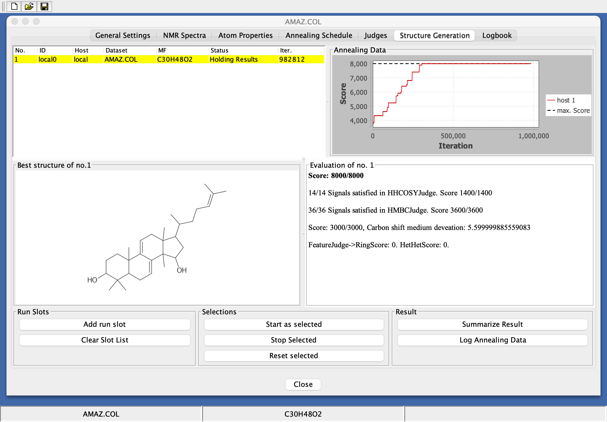
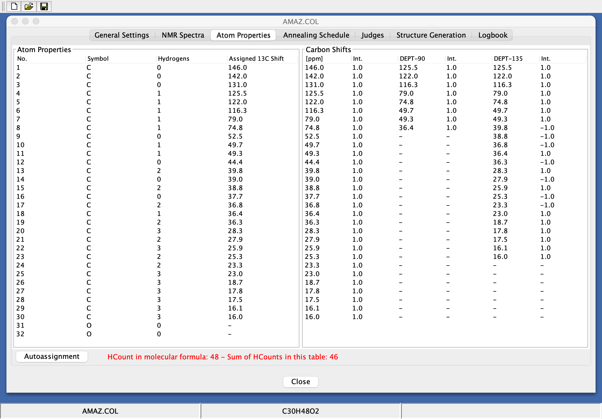
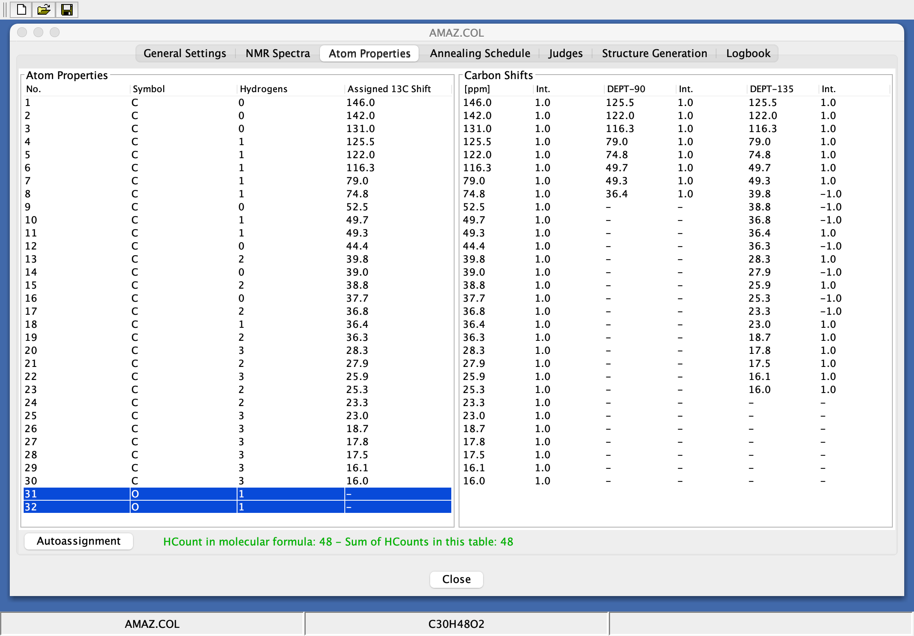
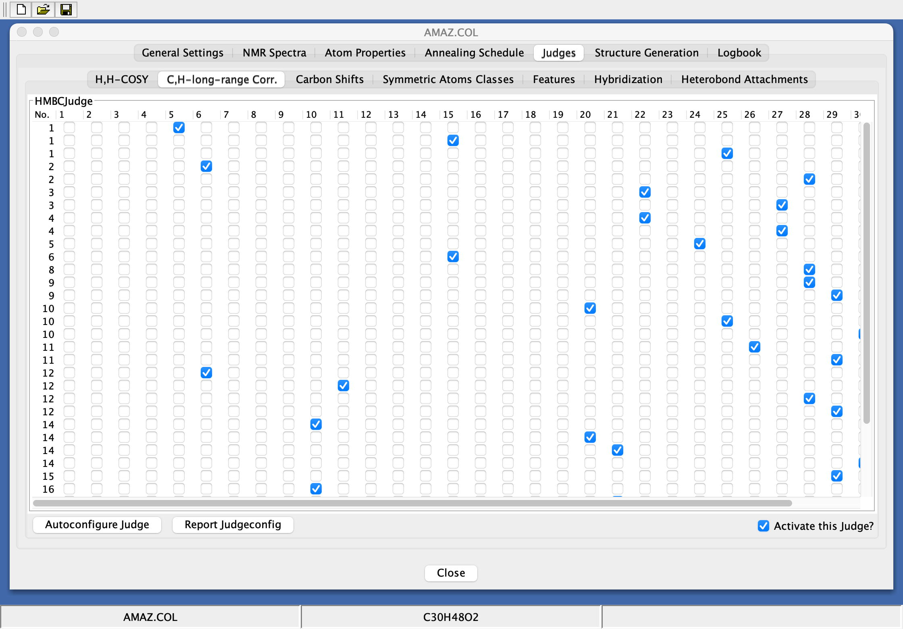
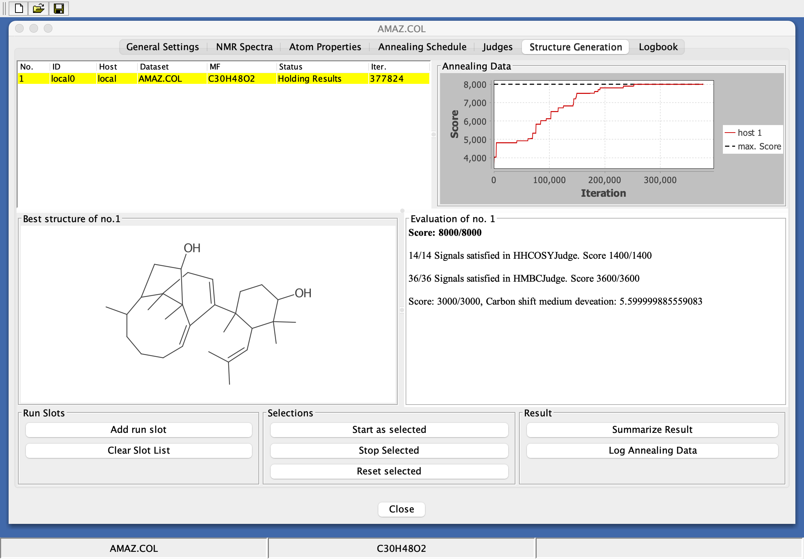
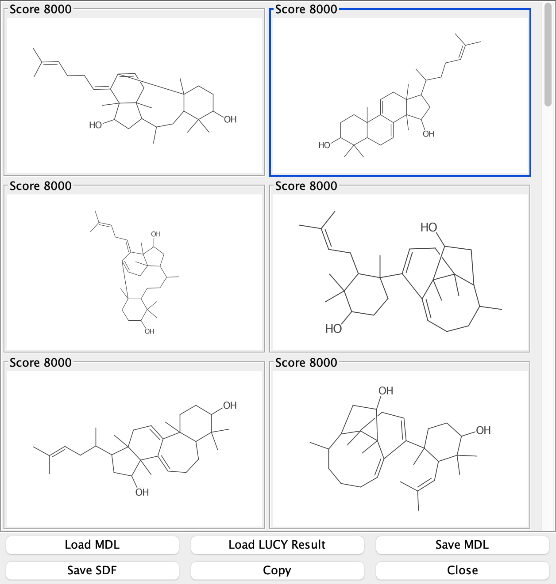
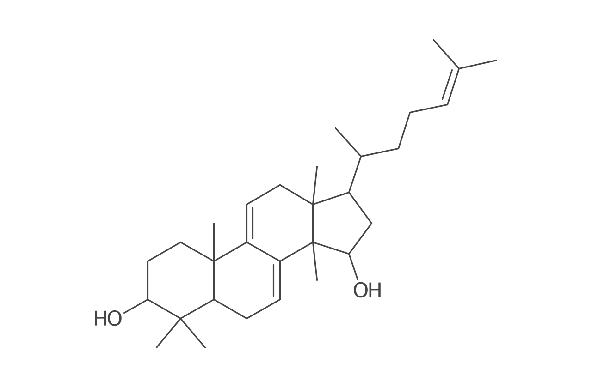

# SENECA: computer-assisted structure elucidation, the 2001 version on modern Java

SENECA proposes structures for an unknown organic compound from its molecular formula and its NMR spectra.
This repository holds the program as published in 2001, ported to Java 25 and the Chemistry Development Kit
(CDK) 2.13 with its original user interface, and packaged as a macOS app for Apple silicon.

[](https://github.com/steinbeck/seneca-jcics-modern/releases/latest)
[](#build-from-source)
[](#installation)
[](LICENSE)
[](https://doi.org/10.1021/ci000407n)

<p align="center">

</p>

*One of 20 measured runs: Seneca.app after a run on the polycarpol example with the optional Features judge
and `--seed=3`. After 982,812 iterations the score is 8000 of 8000, and the best structure is polycarpol. The
other 19 runs (9 with Features, 10 without) ended on a different structure with the same score, and polycarpol
was among their other results; the [quick start](#quick-start-run-polycarpol-step-by-step) explains why.*

**Deutsche Anleitung:** [docs/USER-GUIDE.md](docs/USER-GUIDE.md)

## Contents

- [What SENECA does](#what-seneca-does)
- [Installation](#installation)
- [Quick start: run polycarpol step by step](#quick-start-run-polycarpol-step-by-step)
- [The example datasets](#the-example-datasets)
- [Your own data](#your-own-data)
- [Options and files of the app](#options-and-files-of-the-app)
- [Build from source](#build-from-source)
- [How faithfulness to the 2001 program is verified](#how-faithfulness-to-the-2001-program-is-verified)
- [Repository layout](#repository-layout)
- [Citation](#citation), [Related repositories](#related-repositories), [Contact](#contact),
  [Licence](#licence), [Acknowledgements](#acknowledgements)

## What SENECA does

Given a molecular formula, SENECA searches its constitutional isomers for the ones that best explain the
measured NMR data. It starts from a random connected structure and changes it step by step. Each step
rearranges the bonds among four randomly chosen atoms (the move of J.-L. Faulon, *J. Chem. Inf. Comput. Sci.*
1996, 36, 731), which keeps the valence and hydrogen count of every atom. Each new candidate is scored, and
simulated annealing decides whether to keep it: a better candidate is always accepted, a worse one with a
probability that falls as the "temperature" is lowered. The search has settled when the score of the current
structure has not improved for 3 × **Plateau Steps** iterations (30,000 with the annealing schedule of the
polycarpol file). If the best score found then equals the maximum possible score, the run ends. If not, SENECA
raises the temperature again ("reheating") to get out of the local optimum and goes on; after the eighth
reheating, the next time the search settles the run stops with the best structure found.

The score is the sum of what a set of *judges* award. Each judge compares the candidate with one kind of data
(the names are the sub-tabs of the Judges tab):

| Judge | Data it uses | What it awards |
|---|---|---|
| H,H-COSY | H,H-COSY and one-bond C–H correlations | 100 for each COSY correlation whose two protons sit on carbons that are bonded in the candidate |
| C,H-long-range Corr. | HMBC and one-bond C–H correlations | 100 for each correlation the candidate explains as a 2J or 3J coupling, 5 for a 4J coupling |
| Carbon Shifts | assigned 13C shifts | 100 for each carbon whose measured shift lies within the confidence limit of the shift predicted from its direct neighbours (W. Bremser's table of one-sphere HOSE codes, which describe the atoms and bond types around a carbon) |
| Features | only the candidate itself | penalties only: −500 per three-membered ring, −300 per four-membered ring, −5 per bond between two heteroatoms |
| Symmetric Atoms Classes | carbons with identical shifts | 500 for each pair of such carbons that are topologically equivalent in the candidate. Kept from 2001: it adds far less to the maximum score than it awards (1 point instead of 500 for two equivalent carbons), so with this judge active a score can exceed the maximum and a run can stop before the other judges are satisfied. |
| Hybridization, Heterobond Attachments | tables filled in by hand | kept as in 2001, where both tables are cleared when a run starts, so they score 0; Hybridization still adds to the maximum score, which then cannot be reached. Leave them inactive. |

The hydrogen count of every heavy atom is fixed before the run (from the DEPT spectra, plus what you enter for
OH and NH groups) and never changes during it. SENECA works on constitutions; stereochemistry is not
considered.

SENECA was published in 2001 ([Steinbeck, *J. Chem. Inf. Comput. Sci.* 2001, 41, 1500–1507](https://doi.org/10.1021/ci000407n)).
It was then a distributed system: a Java client sent runs to compute servers over Java RMI. The 2001 source
code is archived in [steinbeck/seneca-jcics](https://github.com/steinbeck/seneca-jcics). This repository ports
exactly that version to JDK 25 and CDK 2.13. The algorithm, the judges and the windows are those of 2001; RMI
is gone, and runs execute in threads inside the app.

"Faithful" means that everything that affects a score or the course of a search is reproduced exactly,
including the oddities of the 2001 code, and that random numbers are drawn at the same points in the same
order. With the same seed, the port and the 2001 program take the same path, step by step. This is checked
against a golden master recorded by running the original code ([details below](#how-faithfulness-to-the-2001-program-is-verified)).
Where the 2001 program crashed, hung or lost data, the app fixes it, and every such change is listed in
[docs/port/DEVIATIONS.md](docs/port/DEVIATIONS.md).

## Installation

**Requirements:** a Mac with Apple silicon (M1 or later). The app declares macOS 11 (Big Sur) as its minimum
and was tested on macOS 26 (Tahoe). It brings its own Java runtime. The app does not run on Intel Macs. On an
Intel Mac you can build SENECA from source and start it with `scripts/run-app.sh` (set `JAVA_HOME` to your
JDK 25 first; untested; see [Start the GUI without building the app](#start-the-gui-without-building-the-app)).

1. Download `Seneca-1.0.0-macOS-arm64.dmg` (about 40 MB) from the
   [latest release](https://github.com/steinbeck/seneca-jcics-modern/releases/latest).
2. Optional: download `Seneca-1.0.0-macOS-arm64.dmg.sha256` into the same folder and check the image:

   ```bash
   cd ~/Downloads
   shasum -a 256 -c Seneca-1.0.0-macOS-arm64.dmg.sha256
   ```

   The output should be `Seneca-1.0.0-macOS-arm64.dmg: OK`.
3. Open the disk image and drag **Seneca** onto **Applications**.

### First start

The app is signed ad hoc, not with an Apple Developer ID, and it is not notarized by Apple. macOS therefore
blocks the first start of a downloaded copy. You allow it once.

**macOS 15 (Sequoia) and later:**

1. Double-click Seneca in Applications. macOS says *“Seneca” Not Opened* and that Apple could not verify it
   is free of malware. Click **Done**, not Move to Trash.
2. Open **System Settings > Privacy & Security** and scroll down to the **Security** section. Next to
   *“Seneca” was blocked to protect your Mac.* click **Open Anyway**.
3. In the dialog *Open “Seneca”?* click **Open Anyway** and confirm with your password or Touch ID.

**macOS 14 and earlier** (not tested): Control-click Seneca in Applications, choose **Open**, then click
**Open**.

**Any version, in Terminal:** remove the quarantine flag that macOS sets on downloaded files; the app then
starts normally.

```bash
xattr -drs com.apple.quarantine /Applications/Seneca.app
```

The disk image also contains these steps as `README.txt`, plus `LICENSE.txt` and `THIRD-PARTY-NOTICES.md`.

## Quick start: run polycarpol step by step

Polycarpol (lanosta-7,9(11),24-triene-3β,15α-diol, C30H48O2) is one of the examples of the 2001 paper. Its
dataset holds 13C, DEPT-90, DEPT-135, H,H-COSY, HMBC and one-bond C–H correlation data. The paper reports
about 350,000 iterations and 12 minutes on a 600 MHz computer of the time; on an Apple M2 a run takes from
about 10 seconds to 3 minutes, depending on the seed and on what else the machine is doing. The interface is
in English, with the texts of 2001.

Optional: to get exactly the run shown in the screenshots of steps 6 and 7 (seed 6), start Seneca from
Terminal with a fixed random seed (after you have allowed the first start as described above; quit Seneca
first if it is running):

```bash
open /Applications/Seneca.app --args --seed=6
```

If you start Seneca normally, the steps are the same, but the number of iterations, the best structure drawn
and the position of polycarpol among the results will differ.

1. **Open the example.** In the menu bar at the top of the screen, choose
   **File > Open > Example Dataset > polycarpol**. A dataset window titled
   **AMAZ.COL** opens (the name the dataset had in 2001), and the status bar shows `AMAZ.COL` and `C30H48O2`.
   The window has seven tabs: General Settings, NMR Spectra, Atom Properties, Annealing Schedule, Judges,
   Structure Generation and Logbook.

2. **Assign the 13C shifts.** Open the tab **Atom Properties**. The table lists the 32 heavy atoms: rows 1–30
   are carbons, rows 31 and 32 oxygens. The red text next to the **Autoassignment** button reads
   `HCount in molecular formula: 48 - Sum of HCounts in this table: 0`. Click **Autoassignment**. Each carbon
   atom gets one 13C signal, in the order of the 13C spectrum (here from 146.0 ppm in row 1 down to 16.0 ppm
   in row 30), and its number of hydrogens from DEPT-90 and DEPT-135. The atoms are not connected yet; this
   only defines the atoms the search works with. Because every atom keeps its shift, a structure in SENECA is
   a constitution together with an assignment of the signals to its carbons. The text is still red and now
   reads `HCount in molecular formula: 48 - Sum of HCounts in this table: 46`. The two missing hydrogens are
   the hydroxyl protons, which DEPT does not show.

   

3. **Add the hydroxyl hydrogens.** Double-click the **Hydrogens** cell of row 31 (Symbol O), type `1` and
   press Return. Do the same for row 32. Values from 0 to 4 are accepted; anything else is ignored. The text
   turns green: `HCount in molecular formula: 48 - Sum of HCounts in this table: 48`.
   This step matters: SENECA never changes hydrogen counts during a run, so with wrong counts the right
   structure cannot be reached at all. SENECA does not warn you; a run starts even while the text is red.

   

4. **Configure the judges.** Open the tab **Judges**. All judges are inactive after opening a file. In each of
   the sub-tabs **H,H-COSY**, **C,H-long-range Corr.** and **Carbon Shifts**, click **Autoconfigure Judge**
   (bottom left). The judge fills its table from the spectra, and **Activate this Judge?** (bottom right)
   becomes ticked. You do not need to change anything in these tables. Leave the other sub-tabs alone;
   [Features](#optional-the-features-judge) is discussed below.

   

5. **Annealing schedule.** Nothing to do. The tab **Annealing Schedule** already holds the schedule stored in
   the file: Initial Accept. Prob. 0.8, Plateau Steps 10000, Cooling Factor 0.95, max. Uphill Steps 1000.
   Initial Accept. Prob. sets the starting temperature: at first, a candidate that scores worse by a typical
   amount is accepted with this probability. The temperature is multiplied by the Cooling Factor after
   Plateau Steps iterations, or earlier once max. Uphill Steps candidates that score at least as well as the
   current structure have been accepted at that temperature.

6. **Run.** Open the tab **Structure Generation**. In the group **Run Slots**, click **Add run slot**. A row
   appears with ID `local0`, Host `local` and Status `idle`. Click the row to select it, then click
   **Start as selected** in the group **Selections**. Nothing happens if no row is selected.

   While the run goes on, Status shows `Running` and **Iter.** counts the iterations (refreshed every two
   seconds). The chart **Annealing Data** plots the best score so far (red line "host 1") against the
   iterations, with the maximum possible score as the dashed line "max. Score" at 8000. Below the table,
   **Best structure of no.1** shows the best structure found so far; below the chart, **Evaluation of no. 1**
   shows its scores.

   With `--seed=6` the run ends after 377,824 iterations. Status changes to `Holding Results`, and the
   evaluation reads:

   ```text
   Score: 8000/8000
   14/14 Signals satisfied in HHCOSYJudge. Score 1400/1400
   36/36 Signals satisfied in HMBCJudge. Score 3600/3600
   Score: 3000/3000, Carbon shift medium deveation: 5.599999885559083
   ```

   "deveation" is the spelling of 2001. The number is the mean absolute deviation, in ppm, between the measured
   shifts and those predicted from the HOSE code table. The **Logbook** tab shows
   `Maximum score reached. Regular end of calculation.`

   

   The structure in this picture is **not** polycarpol. It is a bridged polycycle with the same score; step 7
   shows where polycarpol is.

7. **Look at all results.** In the group **Result**, click **Summarize Result**. A window
   **Structure Display - AMAZ.COL** opens with the structures the run stored, as tiles titled `Score <n>`.
   During a run, SENECA stores every structure that scores at least as high as the best one so far, unless an
   equally connected structure is already stored (this duplicate test ignores bond orders and which shift
   sits on which atom), and keeps the 30 most recent. With several run slots the window shows those of all
   slots together. The tiles are sorted by score, highest first; structures with equal scores appear in the
   order they were found, numbered left to right, top to bottom. For seed 6 there are 30 tiles. Six of them
   have the score 8000, and they are six different constitutions; polycarpol is tile 2. The run's final
   "Best structure" is the last of the 8000 tiles (here tile 6). Hover over a tile to see its evaluation,
   click it to select it. **Save SDF** writes all structures into one SD file, **Save MDL** one
   molfile per structure, and **Copy** puts the selected structure on the clipboard (as molfile and picture).

   

### Why the best structure is usually not polycarpol

The judges check what was measured: which carbons are bonded (H,H-COSY), which carbons lie two or three bonds
from which protons (HMBC), and whether each carbon's direct neighbours fit its shift. For polycarpol, several
constitutions satisfy all of this equally well. Some of them are bridged polycycles with 7- to 10-membered
rings that a chemist would discard at once. A run does not stop the moment it first reaches 8000: it goes on
until the search settles, and meanwhile stores every further structure that scores as well. "Best structure"
then shows the one found last. The literature structure is usually among them:

<p align="center">

</p>

Ten runs with seeds 1 to 10 and the three judges of the quick start:

| Seed | Iterations | Polycarpol in Summarize Result | Tiles with 8000 |
|---:|---:|---|---:|
| 1 | 761,973 | tile 2, score 8000 | 6 |
| 2 | 435,377 | tile 2, score 8000 | 6 |
| 3 | 3,090,784 | tile 2, score 8000 | 6 |
| 4 | 396,949 | tile 2, score 8000 | 6 |
| 5 | 1,474,652 | tile 7, score 7905 | 2 |
| 6 | 377,824 | tile 2, score 8000 | 6 |
| 7 | 378,934 | tile 2, score 8000 | 6 |
| 8 | 1,361,471 | tile 13, score 7905 | 1 |
| 9 | 403,581 | tile 5, score 8000 | 6 |
| 10 | 2,182,018 | tile 6, score 7905 | 5 |

Every run reached 8000 of 8000, and polycarpol was among the results of every run: with the full score in 7
runs, and with 7905 in 3 (the same constitution with the shifts assigned differently to its atoms). It was
never the run's final "Best structure". Seeds 1 to 3 reproduce the iteration counts recorded with the original
2001 program. The runs took from 22 seconds to about 3 minutes on an Apple M2 that was busy with other work at
the time; on an idle machine seed 6 took 10 seconds instead of 26.

In practice: click **Add run slot** several times, select all rows (click the first, Shift-click the last)
and click **Start as selected**. The runs execute in parallel, each from its own random structure (with
`--seed=n`, slot k uses seed n + k − 1); **Stop Selected** ends the selected runs early. **Summarize Result**
then shows the results of all slots together. Compare the 8000 tiles and judge them as a chemist.

### Optional: the Features judge

Features penalizes three- and four-membered rings and bonds between two heteroatoms. Its maximum is 0, so it
can only lower the score of implausible candidates. For polycarpol it made no difference to the scores of the
structures found: none of the 8000-point structures in the measured runs had a three- or four-membered ring,
and the two OH oxygens cannot be bonded to each other (HO–OH would be a separate molecule). It does change the
course of the search, so a given seed gives a different run, and each iteration takes four to six times longer
(on an Apple M2 the run with seed 3 took about 2 minutes on an idle machine and up to 6 on a busy one). With
Features and `--seed=3` the run ends on polycarpol itself after 982,812 iterations (the picture at the top of
this page). Over seeds 1 to 10 that happened once; polycarpol was among the 8000 tiles in 7 of the 10 runs.

In the 2001 program, Features crashed every recorded polycarpol run in its ring finder. The app catches this
failure and continues ([docs/port/DEVIATIONS.md](docs/port/DEVIATIONS.md), DV-01).

## The example datasets

**File > Open > Example Dataset** lists the ten datasets of the 2001 distribution (also in
[legacy/original/sml/](legacy/original/sml)). They are prepared like polycarpol; the table says what differs.
"Judges" lists the judges for which the file has data; press **Autoconfigure Judge** only in those sub-tabs.
COSY stands for H,H-COSY, HMBC for C,H-long-range Corr., Shifts for Carbon Shifts.

| Dataset | Formula | Compound | Preparation | Judges (max. score) | What to expect |
|---|---|---|---|---|---|
| pinene | C10H16 | α-pinene | Autoassignment | HMBC, Shifts (2400) | The quickest example: the two recorded runs that started needed about 20,000 iterations, well under a second. Leave Features off: it penalizes the four-membered ring of α-pinene, which then scores only 2100. |
| eurabidiol | C15H28O2 | unknown (no reference structure) | Autoassignment; Hydrogens 1 in rows 16 and 17 (O) | HMBC, Shifts (3800) | Every recorded run that finished ended at 3800 on the same constitution, after 60,000 to 105,000 iterations. |
| polycarpol | C30H48O2 | polycarpol | Autoassignment; Hydrogens 1 in rows 31 and 32 (O) | COSY, HMBC, Shifts (8000) | The [quick start](#quick-start-run-polycarpol-step-by-step). |
| monochaetin | C18H20O5 | monochaetin | Autoassignment | COSY, HMBC, Shifts (5000) | Monochaetin scores 5000, but so do structures with O–O bonds; the recorded runs ended on such peroxides after about 400,000 iterations. |
| eupatorio | C13H14O3 | eupatoriochromene | Autoassignment; Hydrogens 1 in row 14 (the first O); Annealing Schedule: **New ->** | Shifts (1300) | Only 13C data can be used, so many constitutions reach 1300; the recorded runs ended on allenes and cumulenes after fewer than 10,000 iterations. The file has no proper title (`untitled1847168977`, the name SENECA gave new datasets in 2001), so that is the window title. |
| narelin | C20H20N2O4 | nareline | none: the file brings shifts and hydrogen counts | COSY, HMBC, Shifts (5600) | Nareline scores 5300. The recorded runs end at 5400 on other constitutions, after about 2 million iterations; none reaches 5600. |
| preconen | C13H16O3 | precocene II | none | COSY, HMBC, Shifts (3000) | Precocene II scores 2900. The recorded runs end at 2900 on a cyclic allene, after about 1.5 million iterations. |
| triterpen | C32H52O3 | unknown (no reference structure) | none | COSY, HMBC, Shifts (8700) | The recorded runs end at about 7400 after about 1.1 million iterations. |
| Hyperaspine | C19H30N2O3 | hyperaspine | Autoassignment; Annealing Schedule: **New ->** | Shifts (1900) | Autoassignment finds 19 shifts but no hydrogen counts, so every atom keeps 0 H and the H line stays red. A run is possible, but its results are meaningless. |
| bn-ye1 | C27H28O6 | unknown (no reference structure) | none possible | none | The file has no 13C shifts. Nothing can be scored, and SENECA refuses to start a run. |

"Recorded runs" are the runs of the original 2001 program with seeds 1 to 3 and the judges listed here
([golden/FORMAT.md](golden/FORMAT.md), "Results of the recording"). **New ->** means: the file has no
annealing schedule; in the tab **Annealing Schedule** click **New ->** to add the default one. If you press
Autoconfigure Judge in a 2D sub-tab for which the file has no correlations, untick **Activate this Judge?**
again; the judge has nothing to score.

## Your own data

1. **File > New Dataset** creates an empty dataset with the default annealing schedule (Plateau Steps 500,
   max. Uphill Steps 50). That is much shorter than the schedule stored with polycarpol (10000 and 1000), which
   the runs on this page used; for a molecule of that size, consider entering the longer values in
   **Annealing Schedule**. Enter the molecular formula in **General Settings**; the atoms are created from it.
2. Enter the spectra in **NMR Spectra**: 13C, DEPT-90, DEPT-135, the one-bond C–H correlation, HMBC
   (C,H long-range) and H,H-COSY, by hand or with **Paste WinNMR pp from clipboard** (a peak list copied from
   Bruker's WinNMR program). A dataset of LUCY, Steinbeck's earlier structure elucidation program (`.col`
   files), can be imported with **File > Import > LUCY dataset**.
3. Then continue as in the quick start: **Autoassignment**, hydrogens on heteroatoms, **Autoconfigure Judge**,
   run.
4. **File > Save > SENECA Dataset** saves the dataset as `.sml`. As in 2001, the judge configuration is not
   saved: after opening a file, press Autoconfigure Judge again.

The order matters: Autoassignment first, then Autoconfigure. Without assigned shifts no judge has anything to
score, and SENECA refuses to start the run with a message that says so.

More detail, in German: [docs/USER-GUIDE.md](docs/USER-GUIDE.md). The `.sml` format is described in
[docs/legacy/feature-inventory.md](docs/legacy/feature-inventory.md), section 7.1.

## Options and files of the app

Options are passed when the app is started from Terminal (quit Seneca first; a Seneca that is already
running ignores them):

```bash
open /Applications/Seneca.app --args --seed=6 --logdir=/tmp/seneca
```

| Option | Effect |
|---|---|
| `--seed=<n>` | reproducible runs: the first run slot uses seed n, the second n + 1, and so on |
| `--iteration-cap=<n>` | ends every run after n iterations |
| `--logdir=<folder>` | writes the log files there instead of into the home folder |
| `--examples=<folder>` | another folder for File > Open > Example Dataset |
| `--smoke[=<report>]` | self-test: opens pinene, runs it, writes a report and quits |

Files the app writes into your home folder, emptied at every start: `seneca.log` (the complete log; the
Logbook tab shows only its newest megabyte), `seneca.results.sdf` (every new best structure) and
`seneca.annealing.log` (written by **Log Annealing Data**). Save results you want to keep (for example with
**Summarize Result > Save SDF**) before you quit. Preferences are kept in
`~/Library/Application Support/io.github.steinbeck.seneca/seneca.props`.

Double-clicking an `.sml` file opens it in Seneca. While a run is going on, the app asks macOS not to slow it
down in the background (App Nap).

## Build from source

Only macOS on Apple silicon has been tested. The interface is plain Swing with macOS additions, so other
systems with JDK 25 may work from source; this has not been tried.

You need:

- JDK 25 with `jlink` and `jpackage`, for example Homebrew's `openjdk` or Eclipse Temurin 25;
- Maven 3.9;
- for the app: macOS with the Xcode command line tools, and Python 3.

```bash
git clone https://github.com/steinbeck/seneca-jcics-modern.git
cd seneca-jcics-modern
export JAVA_HOME=/opt/homebrew/opt/openjdk/libexec/openjdk.jdk/Contents/Home   # or another JDK 25
mvn test
```

`mvn test` runs the default suite (about 1,060 tests, a few minutes). The GUI tests drive the interface
programmatically without showing a window and write pictures of every window to `target/gui-shots/`. One of
them, `GuiEndToEndTest`, loads pinene and eurabidiol through the interface (polycarpol in the full suite),
configures them as in 2001, runs them with fixed seeds and compares the results with the golden master.
`ReadmeWalkthroughTest` performs the quick start of this page through the interface and checks what its steps
say you should see.

The full suite also runs the long golden runs and compares the port directly with the 2001 code (more than
5,700 tests, about 40 minutes). It needs the 2001 classes, built once:

```bash
legacy/runnable/build.sh
mvn -Pslow,oracle test
```

`mvn test` does not download every Maven plugin that packaging needs; the first calls in the next two
sections fetch the rest. After that, everything except the oracle profile is in the local Maven repository
and `mvn -o` works offline; `-Poracle` needs one online run (`mvn -Pslow,oracle test`) first.

### Start the GUI without building the app

```bash
mvn -DskipTests package
MVN_OFFLINE= scripts/run-app.sh
```

To open a file at once, add its path: `scripts/run-app.sh legacy/original/sml/pinene.sml`.
`JAVA_OPTS="-Dseneca.logdir=/tmp/seneca" scripts/run-app.sh` keeps the log files out of the home folder. The
scripts call Maven offline (`-o`) by default; `MVN_OFFLINE=` (empty) lets a call download what is missing,
which the first call needs.

### Build the Mac app and the disk image

`RUNTIME_JDK=temurin` downloads the Apple silicon JDK and works only on an Apple silicon Mac. On an Intel Mac,
set `RUNTIME_JDK` to an x64 JDK 25 directory instead (untested); `build-dmg.sh` checks that all binaries have
the same architecture and names the image after it.

```bash
MVN_OFFLINE= RUNTIME_JDK=temurin scripts/build-app.sh   # dist/Seneca.app
scripts/launch-test.sh                                  # starts the app unattended, checks it, quits it
scripts/build-dmg.sh                                    # dist/Seneca-<version>-macOS-arm64.dmg and .sha256
scripts/collect-sources.sh                              # source code of the bundled libraries and runtime
open dist/Seneca.app
```

`build-app.sh` builds the jar, collects it with its 27 libraries and the ten example datasets, draws the icon
(α-pinene, drawn by CDK), makes a trimmed Java runtime with `jlink` and the app with `jpackage`, registers the
`.sml` file type and signs the app ad hoc. `RUNTIME_JDK=temurin` takes the runtime from Eclipse Temurin
25.0.4.1+1, downloaded once into `~/Library/Caches/seneca-build` and checked against a pinned SHA-256. A runtime
made from Homebrew's `openjdk` loads libraries from `/opt/homebrew` and therefore runs only on Macs with those
Homebrew packages; `build-app.sh` warns about it, and `build-dmg.sh` refuses to package such an app.

`launch-test.sh` starts the app four times; its windows appear for a few seconds. The self-test opens pinene,
runs it with seed 1 and must reproduce the 2001 result (21,248 iterations, 2400 of 2400). The fourth start
checks that a run in the background is not slowed down; it needs an otherwise idle Mac and takes about a
minute (`SPEED_TEST=0` skips it). `build-dmg.sh` checks the signature, the version, the runtime, the file
permissions and the notices before it packs the image, and checks the copy inside the image afterwards.
`collect-sources.sh` (online) gathers the source code of the 27 libraries and of the Java runtime, which every
release carries next to the image. Details: [dist/README.md](dist/README.md) and
[docs/port/gui-design.md](docs/port/gui-design.md), section 15.

### Command line

The command-line program runs the same engine without a window:

```bash
mvn -DskipTests package dependency:copy-dependencies -DincludeScope=runtime
java -Xss16m -cp "target/classes:target/dependency/*" io.github.steinbeck.seneca.cli.Main \
    generate legacy/original/sml/polycarpol.sml --profile paper --seed 6
```

```text
SENECA structure generation (StoIcGenT V 0.6 beta, (c) 1998, 1999, 2000, Christoph Steinbeck)
dataset   AMAZ.COL (polycarpol), C30H48O2, 32 heavy atoms
profile   paper: HHCOSYJudge, HMBCJudge, HOSECodeJudge; max score 8000
random    seed 6, compat DEFAULT
result    finished (max_score_reached) after 377824 iterations, 21.0 s
best      8000/8000  OC1CCC(C2=CCC3(C)C4CC(O)C3(C2=CCCCC4C)C)(C)C(C=C(C)C)C1(C)C
results   30 (newest first)
...
```

`generate` prepares the dataset as the quick start does (including the two hydroxyl hydrogens), runs it once
and lists the stored structures as SMILES, newest first. The `--profile` sets the judges: `gui` (the default:
H,H-COSY, C,H-long-range Corr., Carbon Shifts and Features, as far as the file has data), `paper` (the same
without Features), `all` (all seven judges, Autoconfigure only) and `manual` (H,H-COSY, C,H-long-range Corr.,
Carbon Shifts and Symmetric Atoms Classes, plus Hybridization and Heterobond Attachments with tables filled in
by a fixed rule, to exercise those judges); details in [golden/FORMAT.md](golden/FORMAT.md), "The GUI recipe".
Further options: `--seed n`, `--cap n` (iteration limit), `--verbose` (the log on stderr), `-o results.sdf`.
Note the spelling: the command line takes `--seed 6` and `--cap n`, the app `--seed=6` and
`--iteration-cap=n`.

The other commands (`echo`, `scores`, `ref`, `traj`, `run`, `record`) write records in the format of the golden
master.

To re-record the whole golden master with the port and compare it with the one recorded from the 2001 code
(including the 72 complete runs; up to about 20 minutes on an Apple M2):

```bash
java -Xss16m -cp "target/classes:target/dependency/*" io.github.steinbeck.seneca.cli.Main \
    record legacy/original/sml /tmp/seneca-record --manifest legacy/harness/summarize.py
scripts/compare-golden.sh /tmp/seneca-record
```

`--datasets pinene` and `--stages echo,scores,ref,traj,run` restrict the recording; `compare-golden.sh` needs
the complete recording, so compare a restricted one file by file with `cmp` against `golden/`. All commands:
[docs/port/design.md](docs/port/design.md), section 10.

## How faithfulness to the 2001 program is verified

**The golden master.** The archived 2001 sources do not compile as they are. Four small source changes make
them build and run on JDK 25: a class missing from the archive was recovered from the 2001 jar; a missing
field was added; and a new class, called from six edited lines, routes every random draw through a generator
that can be seeded ([legacy/runnable/PATCHES.md](legacy/runnable/PATCHES.md)). A harness
([legacy/harness/](legacy/harness)) drove the original classes through the same steps a user takes in the 2001
window and recorded in [golden/](golden):

- each dataset as read and as configured (11 entries: the ten files and one variant of polycarpol);
- the judge scores of 50 fixed structures per dataset, in three judge sets;
- the first 5,000 steps of 88 annealing runs;
- 72 complete runs with fixed seeds;
- the literature structures of the seven identified compounds, scored by the same judges.

The recording was made twice, and both were byte-identical. Format, provenance and findings:
[golden/FORMAT.md](golden/FORMAT.md).

**What the tests check.** Every step of the 88 trajectories and every complete run (iterations, random draws,
temperatures, best score, best structure and every stored result) must equal the golden record. The port's
own recorder reproduces the golden directory byte for byte, except wall-clock times, the provenance file and
the name of the stack frame in crash records. The oracle tests (`-Poracle`) compare the ring finder, HOSE codes,
duplicate test, molfile reading and writing, all seven judges, the file readers and writers and whole runs
directly with the 2001 classes, on random structures and on inputs the golden master does not cover. The GUI
tests drive the Swing interface the way a user does and reproduce golden runs.

**Two modes.** `LegacyCompat.STRICT` reproduces even the failures of 2001, such as the ring-finder crash that
ended 13 of the 30 recorded runs with the Features judge; the golden tests run in this mode.
`LegacyCompat.DEFAULT`, used by the app and by `generate`, fixes crashes, hangs and data loss without changing
any run in which the 2001 code does not fail. `DefaultModeGoldenTest` checks this against the golden runs.

**Documented differences.** Every difference from 2001 is listed with its reason:
[docs/port/DEVIATIONS.md](docs/port/DEVIATIONS.md) for the engine and
[docs/port/gui-design.md](docs/port/gui-design.md), section 12, for the interface. Oddities of 2001 that
decide scores are kept on purpose, for example the two judges that always score 0 and the duplicate test that
ignores bond orders; they are listed in the section "Kept on purpose" of DEVIATIONS.md. The design of the port
is in [docs/port/design.md](docs/port/design.md).

## Repository layout

| Path | Content |
|---|---|
| [src/main/java/io/github/steinbeck/seneca/](src/main/java/io/github/steinbeck/seneca) | the port: `chem` (the 2001 chemistry algorithms, ported line by line where CDK differs), `judges`, `model`, `io` (SML, CML, LUCY, WinNMR), `config` (Autoassignment, Autoconfigure, the GUI recipe), `structgen` (annealing engine, run control), `golden` (record writers), `cli` and `app` (the Swing interface) |
| [src/test/java/](src/test/java), [src/test-oracle/java/](src/test-oracle/java) | tests; the oracle tests against the 2001 classes |
| [golden/](golden) | the golden master recorded with the 2001 code |
| [legacy/original/](legacy/original) | the 2001 source tree, unchanged (identical to steinbeck/seneca-jcics, commit fb5ffa3), with the example datasets in `sml/` |
| [legacy/dist-2001/](legacy/dist-2001) | `seneca-client.jar` as built in 2001 |
| [legacy/runnable/](legacy/runnable) | the 2001 sources made to build and run on JDK 25 |
| [legacy/harness/](legacy/harness) | the recorder of the golden master |
| [legacy/decompiled/](legacy/decompiled) | the 2001 libraries compchem and jmdraw and the 2001 client jar, decompiled by machine (Vineflower) as reference for the port; not original source |
| [docs/legacy/](docs/legacy) | analysis of the 2001 program: architecture, feature inventory, compchem compared with CDK |
| [docs/port/](docs/port) | design, interface design and the list of deviations |
| [docs/USER-GUIDE.md](docs/USER-GUIDE.md) | user guide in German |
| [docs/images/](docs/images), [docs/release-notes/](docs/release-notes) | the pictures of this page; release notes |
| [scripts/](scripts) | `build-app.sh`, `build-dmg.sh`, `launch-test.sh`, `run-app.sh`, `compare-golden.sh`, and two scripts that render the 2001 interface for comparison |
| [dist/](dist) | build output; only `dist/README.md` is versioned |

## Citation

If you use SENECA, please cite the original article:

> Steinbeck, C. SENECA: A Platform-Independent, Distributed, and Parallel System for Computer-Assisted
> Structure Elucidation in Organic Chemistry. *J. Chem. Inf. Comput. Sci.* **2001**, *41* (6), 1500–1507.
> [doi:10.1021/ci000407n](https://doi.org/10.1021/ci000407n)

If it matters which program produced your results, please also cite this port with its version:

> Steinbeck, C. SENECA (2001 JCICS version, modern port), version 1.0.0, 2026.
> https://github.com/steinbeck/seneca-jcics-modern

GitHub's "Cite this repository" shows the article, taken from [CITATION.cff](CITATION.cff).

## Related repositories

- [steinbeck/seneca-jcics](https://github.com/steinbeck/seneca-jcics): the archived 2001 source code.
  [legacy/original/](legacy/original) here is identical to its commit fb5ffa3.
- [steinbeck/seneca](https://github.com/steinbeck/seneca): the later SENECA, rebuilt on the CDK after 2001 and
  licensed under GPL 2.0. It is a separate program and not part of this port.
- [cdk/cdk](https://github.com/cdk/cdk): the Chemistry Development Kit.

## Contact

Questions and problem reports: [GitHub issues](https://github.com/steinbeck/seneca-jcics-modern/issues).

## Licence

SENECA is distributed under its original licence of 1997–1999 ([LICENSE](LICENSE)), whose terms are those of
the Artistic License 1.0. The app also contains third-party libraries and a Java runtime under their own
licences (LGPL 2.1, Apache 2.0, BSD-2-Clause, GPL 2.0 with the Classpath Exception); see
[THIRD-PARTY-NOTICES.md](THIRD-PARTY-NOTICES.md). Their source code is attached to every
[release](https://github.com/steinbeck/seneca-jcics-modern/releases), next to the disk image.

[legacy/](legacy) holds the 2001 distribution as it was published, for reference. It includes third-party
jars (`legacy/original/jar/`) and source files under their own licences, for example five files of the
JChemPaint project in `legacy/original/src/seneca/client/` (GNU GPL 2 or later) and NIST's SciMark 2
benchmark. None of this is part of the app, and [LICENSE](LICENSE) does not cover it.

## Acknowledgements

- The [Chemistry Development Kit](https://github.com/cdk/cdk) lays out and draws the structures, writes
  SMILES and serves as a reference in the tests; with it come Beam, FreeHEP and vecmath.
- [JFreeChart](https://www.jfree.org/jfreechart/) draws the annealing chart.
- [Eclipse Temurin](https://adoptium.net/) provides the Java runtime inside the app.
- The Carbon Shifts judge uses the one-sphere HOSE code table of W. Bremser (*Magn. Reson. Chem.* 1985, 23,
  271); the structure move is that of J.-L. Faulon (*J. Chem. Inf. Comput. Sci.* 1996, 36, 731).
- [Vineflower](https://github.com/Vineflower/vineflower) decompiled the 2001 libraries that exist only as
  class files.
